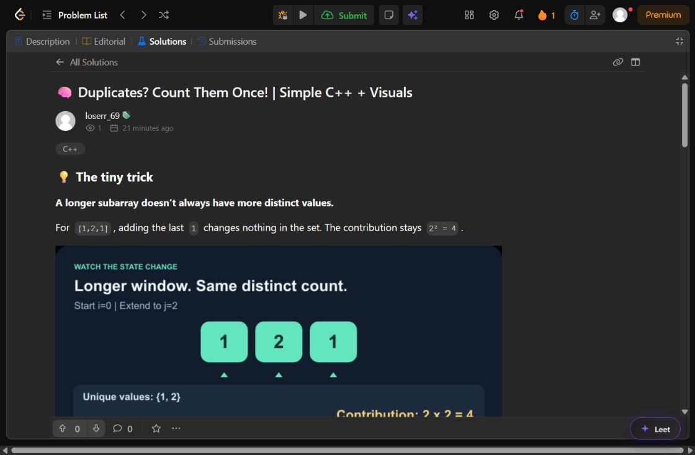
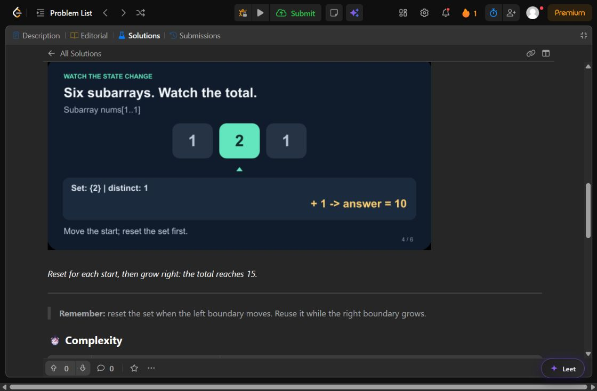
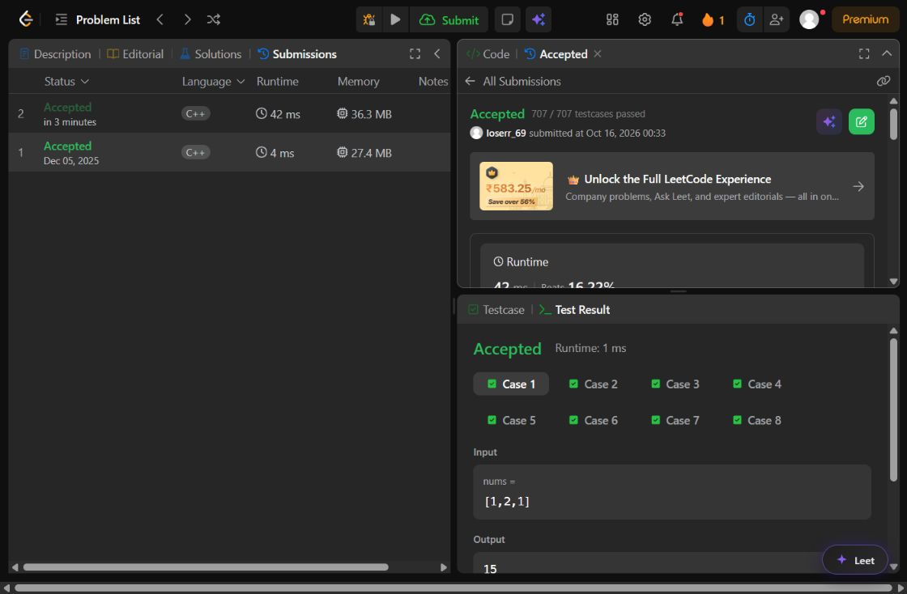
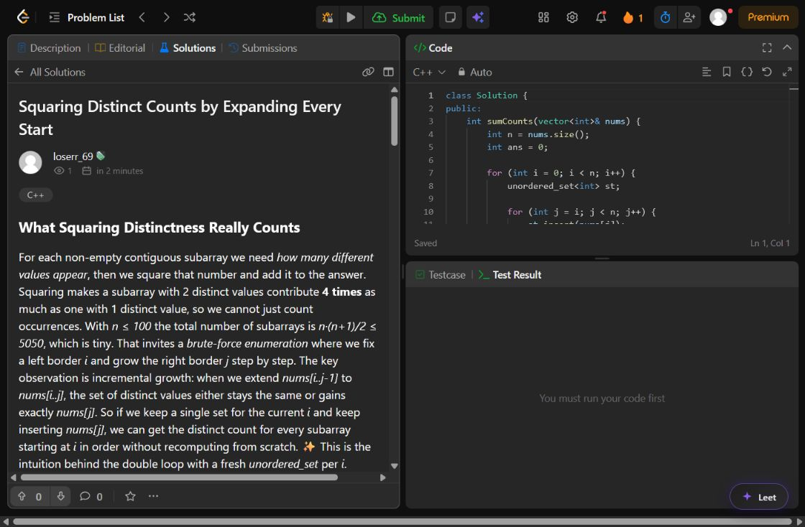

# Verification report — 16 October 2026, IST

## Revision: concise visual article, published and checked

The reference solution was successfully opened and visually inspected in the authenticated Codex browser. Its pacing uses small text blocks, embedded animations, short rules, and diagrams. This revision follows that pacing with original content and media; none of the reference's assets or wording were copied.

The existing solution **8574392** was edited in place through its owner menu. Its title is now **🧠 Duplicates? Count Them Once! | Simple C++ + Visuals**. Five semantic explanations now contain **101 words**, plus compact headings, captions, complexity, and the unchanged accepted code. Two original looping GIFs demonstrate duplicate handling and all six subarrays of `[1,2,1]`, whose running total is `1, 5, 9, 10, 14, 15`. They were uploaded through LeetCode's image toolbar and are hosted on its assets CDN.

One **Update** click saved the revision. Reload verification confirmed the new title, author `loserr_69`, two loaded 720×360 GIFs, and exactly one C++ block matching the accepted submission's source. Both parts of the article were visually checked. The existing URL retains its original slug after editing; no duplicate article was created.

The generator code now enforces concise prose, emoji titles, and truthful performance wording; it creates bounded trace plans, separately reviews their states, renders original GIFs, and stores public assets durably in the existing database. Public hosting failures fall back to readable trace tables. Tests verify real GIF frame changes, loop/delay metadata, markup escaping, public asset delivery, invalid assets, and source preservation.

Validation for this revision: **84 relevant tests passed** across article/router, media, service, publisher, scheduler, API, existing solution sharing, and PIN-gate suites. `npm run build` and `git diff --check` passed. The new provider prompt was exercised live; `gpt-5.6-luna`, `gpt-5.6-terra`, and `gemini-3.7-flash` each timed out at 90 seconds. Accordingly, the published revision was authored and checked directly here; it is not presented as a successful new provider generation or independent provider review. The earlier successful provider run below describes the original article only.

Database deployment/migration and scheduled-account activation remain outside this completed browser revision. The production asset route was tested with mocked database storage, not a deployed PostgreSQL instance.

## Follow-up: successful Codex browser test

The follow-up test used the authenticated **Codex In-app Browser**, account **loserr_69**. Eight custom cases passed with outputs `15, 3, 1, 20, 1, 28, 5050, 8670850`, covering the examples, singleton inputs, alternating values, and both 100-element extremes.

A new [C++ submission 2173331524](https://leetcode.com/problems/subarrays-distinct-element-sum-of-squares-i/submissions/2173331524/) was **Accepted, 707/707 testcases passed** (42 ms, 36.32 MB). This account's older accepted submission used a different algorithm; the new article was linked to the new hash-set submission instead of reusing the other account's earlier submission ID.

The account's **My Solution** filter showed no existing post. The visible **Share my solution** action opened the editor with `submissionId=2173331524`. The prepopulated source was compared with the submitted code; clipboard newline normalization was accounted for. The reviewed article was inserted while retaining that code block exactly once, and the entire editor contents were copied back and verified before Post.

One Post click produced the public article [Squaring Distinct Counts by Expanding Every Start](https://leetcode.com/problems/subarrays-distinct-element-sum-of-squares-i/solutions/8574392/squaring-distinct-counts-by-expanding-ev-rjog/). A reload confirmed the title and author, and the published C++ block matched the submitted source exactly (apart from the renderer's trailing newline). Screenshots, the posted Markdown, and a sanitized result record are stored in `docs/browser-tests/`.

The live test exposed two UI-adapter issues, both fixed: Monaco insertion requires selecting and deleting the old document before `fill()`, and the solution title is rendered as plain text rather than a heading. All **12 publisher tests** passed after those fixes, and `npm run build` passed. The mock now simulates insertion semantics so it catches the original duplication failure.

This verifies the authenticated browser submission and public posting flow. It does **not** apply the PostgreSQL migration, create a production `SolutionPost` database record, or enable scheduled accounts. Deployment-side database integration and scheduler activation remain pending.

Implementation guide, commands, and limitations: [AI solution articles](ai-solution-posts.md).

## Local verification

- `npm run build`: passed.
- `npm run lint`: passed.
- `npx prisma generate`: passed with Prisma 5.22.0.
- `npx prisma validate`: passed using a test-only database URL; validation does not connect to a database.
- `git diff --check`: passed.
- Secret-pattern scan of changed application, configuration, scripts, migration, and documentation paths: no supplied CodeCraft key found. The key was used only in process environments/authorized requests.

The initial baseline run passed 562 tests but timed out during an existing PIN-gate suite setup. A subsequent four-worker full run passed 614 tests and failed an existing CodeChef login fixture assertion. Both existing suites passed in focused reruns without changes to their implementation. The two-worker full run then passed **618 tests**, with **8 skipped**, across **67 passing files** and one skipped database suite. Subsequent focused checks passed all **49 new-module tests**, including the final validator fixes, review-failure draft preservation, and durable scheduler retry budget; two additional regression cases live in the existing solution-sharing suite.

The final two-worker full run passed **621 tests**, with **8 skipped**, across **67 passing files** and one skipped database suite (102.20 seconds). A final missing-configuration persistence case was then added; all **10 service tests** passed again, followed by a successful build. There are now **50 tests in the five new module test files**, plus the two account-selection/stale-date regression tests in the existing solution-sharing suite. Full-run logs remain in ignored `.codex-solution-post-*.log` files.

The new tests exercise model discovery/order, unknown IDs, bounded retries, timeout overrides, output truncation, authentication failure, structured response validation, source-byte preservation, qualified complexity, C++ template Markdown, style/title variation, independent review rejection, draft persistence, compare-and-swap contention, accepted-run reuse, wrong accounts/expired sessions, content-hash approval, exact editor source, duplicate posts, uncertain Post outcomes, publication reconciliation, selected accounts, five-account failure isolation, stale daily pointers, 06:00 IST scheduling, restart retry budgets, and API authentication/input validation.

Database integration is mocked in the new workflow tests. No PostgreSQL server or production database connection was configured in this workspace; migration `0006_solution_posts` has **not** been applied to a live database. Database constraints, replica contention, and migration deployment still require a PostgreSQL integration smoke test.

## Actual C++ test cases

The code was read from the existing LeetCode solution editor associated with submission **2172648157**, for **2913. Subarrays Distinct Element Sum of Squares I**. Its implementation was preserved and compiled with `g++ -std=c++11 -O2` in an ignored scratch harness.

The independent oracle rebuilds an ordered set for each subarray; the submitted implementation incrementally grows an unordered set for each starting index.

**10,348 cases passed**: eight fixed/boundary cases, all 9,840 arrays of lengths 1–8 over values `{1,2,3}`, and 500 seeded random valid arrays of length up to 100. Two additional maximum-size closed-form assertions passed:

| Input | Expected result |
|---|---:|
| 100 equal values | 5,050 |
| 100 different values | 8,670,850 |

These are local executions of the actual C++ source, not LeetCode judge results for a new submission.

## Live CodeCraft requests

The supplied key returned **HTTP 200** from the documented models endpoint. Its returned list contained the configured exact IDs `gpt-5.6-terra`, `gpt-5.6-luna`, and `gemini-3.7-flash`. The API protocol and model-discovery shape were checked against [CodeCraft's documentation](https://codecraftapi.com/docs/models).

Initial live attempts encountered rejected output and timeouts. Captured Luna output identified two overly restrictive validator checks: qualified expected/worst-case complexity and C++ template syntax such as `unordered_set<int>`. Those checks were fixed without weakening HTML/code preservation checks, and regression tests were added.

The complete Luna-generated response was then revalidated using the corrected deterministic validator, rendered with the exact original code, and sent through a separate live Luna technical-review request. Review returned `approved: true` and an empty issue list. The captured original generation was reused during this review, avoiding an unnecessary regeneration request.

Successful sample provenance:

| Stage | Model | Duration | Prompt tokens | Completion tokens | Total tokens |
|---|---|---:|---:|---:|---:|
| Generation | `gpt-5.6-luna` | 63,481 ms | 757 | 3,653 | 4,410 |
| Separate review | `gpt-5.6-luna` | 29,857 ms | 2,425 | 1,719 | 4,144 |

No cost field was returned for these requests; exact cost is unknown. These totals describe the successful sample stages, not all earlier failed/diagnostic requests.

The [sample article](sample-ai-solution.md) includes a verified six-row dry run. Manual review clarified that C++ does not require identity hashing and changed the complexity variable definition to `nums.size()`. The original source occurs exactly once and is unchanged. [Metadata](sample-ai-solution.metadata.json) records the generation/review provenance and manual correction. The sample remains a preview; it is not a published or human-approved production record.

## Initial browser attempt (superseded by the successful follow-up above)

The browser connector did not expose the user's Chrome window. The computer-use skill located the logged-in LeetCode solution editor and read its chosen code. After viewing the editor, Computer Use stopped with: “could not determine the current browser URL on Windows with enough confidence to enforce policy.” No further browser input was attempted after that stop.

**That initial attempt completed no new LeetCode code submission or public solution post.** The reference article was inaccessible through the web tool, so its contents were not copied or used as evidence of verified formatting.

At that point the publishing adapter had only mocked tests. The follow-up above subsequently verified the UI flow and corrected the live selector/insertion issues. The database-backed adapter and its GraphQL publication verification still need deployment integration testing.

No accounts were selected or enabled for the new schedule, no production credentials were stored, and no deployment or recurring public posting was activated.
